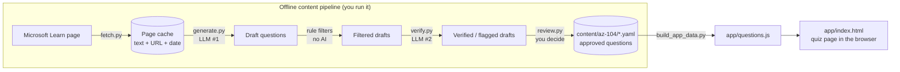

# HibiKodo

HibiKodo is a Duolingo-style app for tech certification prep: short daily lessons, streaks, spaced repetition, a readiness score, and mock exams.

"Hibi" (日々) means daily and "kodo" (鼓動) means pulse or heartbeat, so the idea is a daily pulse for learning.

The first certification covered is Microsoft Azure Administrator (exam code AZ-104). The engine is cert-agnostic, so other certs can be added later.

## Current status (what works today)

| Area | State |
|---|---|
| Exam outline (AZ-104, as of 2026-04-17) | Done: `content/az-104/outline.yaml` |
| Question schema + validator | Done |
| Content pipeline (fetch, generate, verify, review) | Working, run by hand from the command line |
| Approved questions | 4, all on "Manage access to Azure resources" |
| Learner app | A single static quiz page. Answer, explanation, retry-missed-at-the-end. No accounts, streaks, XP or saved progress yet |
| Hosting | Local only |

## High-level design (HLD)

Content is made offline by a pipeline with a human in the loop. The learner app is a static page that only reads the approved result. **No AI runs while someone is using the app.**



### Where the LLM is used

There are exactly two model calls, both offline and both through [pipeline/llm.py](pipeline/llm.py):

| # | Step | Script | Model (default) | What it does |
|---|---|---|---|---|
| 1 | Generate | `generate.py` | `openai/gpt-oss-20b` | Reads one docs page and writes draft questions with a verbatim supporting quote |
| 2 | Verify | `verify.py` | `openai/gpt-oss-120b` | Re-reads the page plus one question and checks: the key is supported, no distractor is also correct, nothing contradicts the page |

Everything else is plain code: fetching, the quote and duplicate filters, the validator, the review tool, and the quiz page. The provider is Groq's free tier (OpenAI-compatible API). Models are different on purpose so the checker does not simply agree with the writer.

**Why not trust the model alone?** LLMs get Azure details wrong (tiers, limits, defaults, retired services). So every question must pass four independent safeguards before a learner sees it:

1. The supporting quote must appear **verbatim** in the stored page (code check, not AI).
2. A second model must agree the key is supported and unambiguous.
3. You read it and approve it.
4. (Planned) A report button in the app sends bad questions back to the review queue.

## Low-level design (LLD)

### Repo layout

```
content/
  schema.md              question schema and rules
  az-104/
    outline.yaml         domains, weights, skills, objectives (pinned to the official guide)
    <skill>.yaml         approved questions, one file per skill
pipeline/                Python, run from the repo root
  common.py              paths, page cache lookup, text normalisation
  fetch.py               step 1
  generate.py            step 2 (LLM #1 + rule filters)
  verify.py              step 3 (LLM #2)
  review.py              step 4 (human approve / reject / edit)
  validate.py            schema + outline checker
  build_app_data.py      exports questions for the app
  llm.py                 the only file that talks to a model provider
  cache/                 fetched pages (git-ignored)
  drafts/                questions awaiting review (git-ignored)
app/
  index.html             the quiz page (HTML, CSS and JS in one file)
  questions.js           generated by build_app_data.py (git-ignored)
infra/                   Bicep goes here when hosting moves to Azure
```

### Pipeline, step by step

| Step | Command | Reads | Writes | Notes |
|---|---|---|---|---|
| 1 Fetch | `fetch.py <url>` | Microsoft Learn | `pipeline/cache/pages/<hash>.json` | Only `learn.microsoft.com` over https is allowed. Stores `{url, title, retrieved_at, text}` |
| 2 Generate | `generate.py <url> <domain> <skill> [count]` | cached page, existing questions | `pipeline/drafts/<skill>.yaml` | Asks for 4 questions per call, pauses 30 s between calls (free-tier limit), then runs the filters below |
| 3 Verify | `verify.py <skill>` | drafts + cached page | same drafts file, adds `verification` | Failed questions get `status: flagged` and show the reason in review |
| 4 Review | `review.py <skill>` | drafts file | `content/az-104/<skill>.yaml`, remaining drafts | a / r / e / s / q. Saves after every decision. Re-checks schema and quote before approving |
| 5 Validate | `validate.py` | `content/` | nothing (exit code) | Run any time; exits 1 on errors |
| 6 Export | `build_app_data.py [--include-drafts]` | approved questions (and drafts with the flag) | `app/questions.js` | Only the fields the app needs |

**Rule filters in `generate.py`** (no AI): schema valid, quote found verbatim in the page (after whitespace and quote normalisation), stem not more than 70% similar to any existing question or draft, and model output of the expected shape (malformed items are dropped, not crashed on).

**Question ids** look like `az-104.<domain>.<skill>.0001` and are assigned by the pipeline. The full field list and rules are in [content/schema.md](content/schema.md).

### Learner app, how it works now

[app/index.html](app/index.html) loads `questions.js` (a global `window.QUESTIONS` array) and runs entirely in the browser:

1. **Start:** all questions are shuffled into a queue. Answer options are shuffled too, so position never gives the answer away.
2. **Answer:** clicking an option on single-answer questions locks it in immediately. Multi-select questions show checkboxes and a Check button.
3. **Feedback:** correct options turn green, a wrong pick turns red, and the explanation plus a "Learn more" link to the source page appear.
4. **Retry:** a missed question is pushed to the **end of the queue** with a "Try again" tag. It keeps returning until answered correctly.
5. **Finish:** shows the first-try score and lists what you missed the first time. "Practice again" reshuffles and restarts.

State lives only in memory: reloading the page starts a new lesson. There is no server, account, database or network call (apart from the link out to Microsoft Learn).

### Configuration

Copy `.env.example` to `.env` and fill in the key. `.env` is git-ignored.

| Variable | Default | Purpose |
|---|---|---|
| `GROQ_API_KEY` | none (required for generate/verify) | Free key from console.groq.com |
| `GEN_MODEL` | `openai/gpt-oss-20b` | Model that writes drafts |
| `VERIFY_MODEL` | `openai/gpt-oss-120b` | Model that checks them |
| `LLM_BASE_URL` | `https://api.groq.com/openai/v1` | Point at another OpenAI-compatible provider |

Free-tier notes: Groq's free plan caps tokens per minute (8,000 for the 20B model when this was written), so requests are small and paced. If you hit a limit the call retries, then stops; nothing is billed on the free plan. Model ids change over time, so if a call returns 404, copy the id from the Groq model list.

## Getting started

Requires Python 3.10+. From the repo root, in PowerShell:

```powershell
python -m venv .venv
.venv\Scripts\python -m pip install -r pipeline\requirements.txt
copy .env.example .env      # then paste your GROQ_API_KEY into .env
.venv\Scripts\python pipeline\validate.py
```

Make questions:

```powershell
.venv\Scripts\python pipeline\fetch.py https://learn.microsoft.com/en-us/azure/role-based-access-control/scope-overview
.venv\Scripts\python pipeline\generate.py https://learn.microsoft.com/en-us/azure/role-based-access-control/scope-overview identities-governance resource-access 8
.venv\Scripts\python pipeline\verify.py resource-access
.venv\Scripts\python pipeline\review.py resource-access
```

Play them:

```powershell
.venv\Scripts\python pipeline\build_app_data.py
.venv\Scripts\python -m http.server 8765 --directory app
```

Then open http://localhost:8765. Add `--include-drafts` to `build_app_data.py` to preview unreviewed drafts as a learner would.

## Content policy

- Facts come from the official skills outline, Microsoft Learn, and Azure documentation. Questions are written in original wording and link back to the source page.
- Every question carries a `source_url`, a verbatim supporting `quote`, a retrieval date, and a `last_reviewed` date.
- No brain dumps, ExamTopics, leaked exam questions, or other courses' practice tests are used. The validator enforces the allowed-host list.

## Known issues

- Approved question 0005 is recall-style ("which is NOT...") and 0006 is basic; both are candidates for replacement by harder ones.
- Generation from short overview pages tends toward easy, recall-style questions. The prompt now demands application scenarios; deeper source pages help more.
- Nothing has automated tests yet; the pipeline was checked by hand and with `validate.py`.

## Roadmap

Following the build plan: more content per domain, then the MVP app (skill tree, 5-question lessons, streak and XP, spaced-repetition queue, report button, saved progress), then readiness score, exam-date planner and timed mocks, then moving hosting to Azure domain by domain (Entra ID, Key Vault, VNet, Monitor, Bicep, CI/CD) as each exam domain is studied.

## Disclaimer

HibiKodo is an independent project. It is not affiliated with, endorsed by, or sponsored by Microsoft. "Microsoft", "Azure", and "AZ-104" are trademarks of Microsoft Corporation and are used here only to describe the subject matter of the exam being studied.
